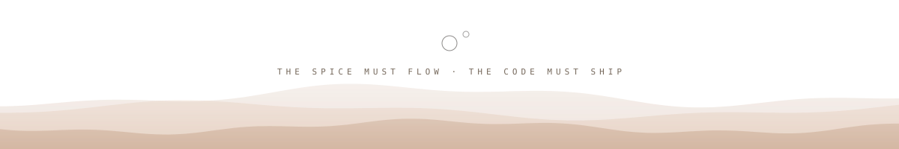

<!-- ◈ ─────────────────────  house ivy-kilgore  ───────────────────── ◈ -->

<a href="https://aaleeyah.net">
  <picture>
    <source media="(prefers-color-scheme: dark)" srcset="./assets/hero-dark.svg">
    
  </picture>
</a>

  <a href="#sietch">the sietch</a> &nbsp;◈&nbsp;
  <a href="#spice">the spice</a> &nbsp;◈&nbsp;
  <a href="#stillsuit">the stillsuit</a> &nbsp;◈&nbsp;
  <a href="#walk">the long walk</a> &nbsp;◈&nbsp;
  <a href="#water">water of life</a>

 

<!-- ─────────────────────────── I · the sietch ─────────────────────────── -->

<picture>
  <source media="(prefers-color-scheme: dark)" srcset="./assets/h-sietch-dark.svg">
  
</picture>

  <i>i make things look pretty, and then i make them work.</i>

  Software developer and designer out of Ohio. I build full-stack apps in <b>TypeScript</b>, <b>React</b> and <b>C# / .NET</b>, 
  wire them to real data, then fuss over every pixel until the interface feels inevitable. 
  I came to code from drawing, and I never really stopped.

<b>◈ &nbsp;dossier</b>

 

| ◈ | dossier |
|---|---|
| **house** | Ivy-Kilgore |
| **homeworld** | Ohio, which is a desert with snow |
| **trained in** | C# · .NET · TypeScript · React · SQL · NetSuite SuiteScript |
| **weapon of choice** | a Figma file and strong opinions about kerning |
| **currently** | building mood-aware music tools and a habit app for ADHD brains |
| **status** | `fear is the mind-killer.` |

<b>⟡ &nbsp;choose your path: i'm hiring</b>

 

- **Full-stack:** React, TypeScript, Next.js, Node + Fastify, Prisma, C# / .NET, Blazor
- **Data:** SQL Server, MySQL, PostgreSQL, Supabase. I led an ERP migration from Taiga to NetSuite and wrote the SuiteScript forms, actions and buttons that came with it
- **Engineering habits:** .NET services and unit tests at Red Hawk Technologies, Docker + nginx deploys, LLM pipelines with explainable output
- **Design:** Figma, Illustrator, Photoshop. I run my own creative studio, so I design *and* ship
- **Looking for:** software engineering or design-engineering roles, remote or around Cincinnati

→ [LinkedIn](https://www.linkedin.com/in/aaleeyah-ivy-kilgore-823818204/) &nbsp;·&nbsp; [aaleeyah.net](https://aaleeyah.net)

<b>⟡ &nbsp;choose your path: i'm a developer</b>

 

- Start with **[Moodify](https://github.com/AaleeyahIvy/Moodify)**: a prompt goes to an LLM, gets mapped to audio features, then matched against Spotify, and every pick explains itself.
- **[Aaleeyah.Net](https://github.com/AaleeyahIvy/AaleeyahNet)** has a Next.js 14 + anime.js front, a tiny likes API, and a Docker / nginx setup you're welcome to borrow.
- Issues, PRs and code critique are all welcome. Pull Shark is my favorite badge for a reason.

<b>⟡ &nbsp;choose your path: i'm a fellow dreamer</b>

 

- I draw, design, and run a small creative studio called **MadeDHD**.
- Off-world you'll find me in Overwatch, League or Fortnite, or deep in a playlist.
- I share my sietch with a council of cats. They run the place.
- If something here made your day, [leave a little water on Ko-fi](https://ko-fi.com/J3J0FR7XG).

 

<!-- ─────────────────────────── II · the spice ─────────────────────────── -->

<picture>
  <source media="(prefers-color-scheme: dark)" srcset="./assets/h-spice-dark.svg">
  
</picture>

  <a href="https://github.com/AaleeyahIvy/AaleeyahNet"><picture><source media="(prefers-color-scheme: dark)" srcset="./assets/card-aaleeyahnet-dark.svg"></picture></a>
  <a href="https://github.com/AaleeyahIvy/Moodify"><picture><source media="(prefers-color-scheme: dark)" srcset="./assets/card-moodify-dark.svg"></picture></a>
  <a href="https://github.com/AaleeyahIvy/Yin-Yang"><picture><source media="(prefers-color-scheme: dark)" srcset="./assets/card-yinyang-dark.svg"></picture></a>
  <a href="https://github.com/AaleeyahIvy/SolWars"><picture><source media="(prefers-color-scheme: dark)" srcset="./assets/card-solwars-dark.svg"></picture></a>

<b>◈ &nbsp;in the forge</b> &nbsp;private for now

 

| project | what it is | stack |
|---|---|---|
| **adhDO** | a habit and task app built for ADHD brains | mobile |
| **TradeLab** | backtester and paper-trading bot with momentum and ML strategies | Python |
| **Magic Mirror** | smart-mirror modules: Govee light control, a responsive task list | JavaScript |

<b>◈ &nbsp;deeper in the sand</b> &nbsp;older relics and side quests

 

| relic | what it is | made with |
|---|---|---|
| [Contrast-bot](https://github.com/AaleeyahIvy/Contrast-bot) | a Discord bot for customizing servers and keeping them lively | JavaScript |
| [ImsLabeling](https://github.com/AaleeyahIvy/ImsLabeling) | an inventory API client from my IMS days | JavaScript |
| [CodeCademyProjs](https://github.com/AaleeyahIvy/CodeCademyProjs) | backend engineering coursework | JavaScript |
| [Portfolio](https://github.com/AaleeyahIvy/Portfolio) | the very first portfolio, kept for sentiment | HTML / CSS |

 

<!-- ─────────────────────────── III · the stillsuit ─────────────────────────── -->

<picture>
  <source media="(prefers-color-scheme: dark)" srcset="./assets/h-stillsuit-dark.svg">
  
</picture>

<b>LANGUAGES</b>  
  <picture><source media="(prefers-color-scheme: dark)" srcset="https://skillicons.dev/icons?i=ts,js,cs,py,java,php,html,css&theme=dark"></picture>

<b>FRAMEWORKS</b>  
  <picture><source media="(prefers-color-scheme: dark)" srcset="https://skillicons.dev/icons?i=react,nextjs,tailwind,nodejs,express,dotnet,prisma,electron&theme=dark"></picture>

<b>DATA &amp; DEPLOY</b>  
  <picture><source media="(prefers-color-scheme: dark)" srcset="https://skillicons.dev/icons?i=postgres,mysql,supabase,mongodb,docker,nginx,aws,firebase&theme=dark"></picture>

<b>CRAFT</b>  
  <picture><source media="(prefers-color-scheme: dark)" srcset="https://skillicons.dev/icons?i=figma,ai,ps,vscode,visualstudio,git,github,linux&theme=dark"></picture>

also in the pack: NetSuite SuiteScript · Blazor · SQL Server · anime.js · Krita · Inkscape

 

<!-- ─────────────────────────── IV · the long walk ─────────────────────────── -->

<picture>
  <source media="(prefers-color-scheme: dark)" srcset="./assets/h-walk-dark.svg">
  
</picture>

<picture>
  <source media="(prefers-color-scheme: dark)" srcset="./assets/walk-dark.svg">
  
</picture>

<b>◈ &nbsp;read the trail</b>

 

| when | where | what |
|---|---|---|
| 2026 | **DeveloCode** · Cincinnati | Web Designer |
| 2024 – 2025 | **Red Hawk Technologies** · Wilder, KY | Jr. Software Engineer: .NET services, unit testing |
| 2023 – now | **MadeDHD** | Graphic Designer, my own creative studio |
| 2022 – 2023 | **IMS Company** · Chagrin Falls, OH | HTML Programmer & NetSuite Specialist: led the Taiga → NetSuite migration, SuiteScript forms, actions and buttons, roles and dashboards |
| 2020 – 2022 | **Cuyahoga Community College** | A.A.B. in Computer Programming · 3.8 GPA · Dean's List |

 

<!-- SANDWORM PAUSED: GitHub Actions is blocked by a billing lock on the account.
     Once billing is fixed and the "sandworm" workflow has run once, restore this block
     (swap <!~~ back to <!-- and ~~> back to -->) and put the nav link back.
<!~~ ─────────────────────────── V · sand signals ─────────────────────────── ~~>

<picture>
  <source media="(prefers-color-scheme: dark)" srcset="./assets/h-signals-dark.svg">
  
</picture>

  <picture>
    <source media="(prefers-color-scheme: dark)" srcset="https://raw.githubusercontent.com/AaleeyahIvy/AaleeyahIvy/output/sandworm-dark.svg">
    
  </picture>
   
  <i>something stirs beneath the sand. every commit is spice.</i>

 

-->

<!-- ─────────────────────────── VI · water of life ─────────────────────────── -->

<picture>
  <source media="(prefers-color-scheme: dark)" srcset="./assets/h-water-dark.svg">
  
</picture>

  
  
  
  

  

⟁ &nbsp;place your hand in the box

 

  <i>the needle is at your neck. you feel the burn, and you don't pull away.</i>  
  <b>you passed.</b> welcome to the sietch, wanderer. &nbsp;☾ ☾ 
  now go open an issue and tell me your favorite color palette.

<picture>
  <source media="(prefers-color-scheme: dark)" srcset="./assets/footer-dark.svg">
  
</picture>
